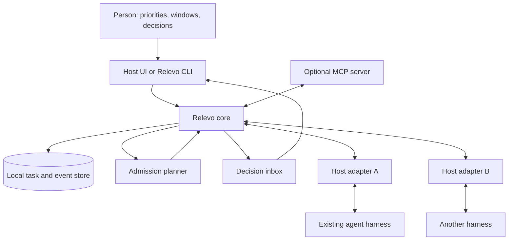

# Proposed architecture

This is a design sketch, not a description of implemented software.

## Components

### Core

The core owns the shared task vocabulary, dependency graph, admission policy, decision inbox, and local state. It does not run a language model by default or replace an agent harness. A first implementation could be a local process backed by SQLite, with a CLI for direct human actions. The storage and transport choices are proposals, not protocol requirements.

The planner should be explainable: every start/prepare/defer recommendation includes a short reason and the inputs it used. A first version can use deterministic rules rather than predictive estimates. Human availability, priority, deadlines, dependencies, and active-work limits are policy inputs; a calendar integration is optional.

### Adapters

Adapters translate between a particular host and Relevo's [draft contract](protocol.md). They advertise supported operations at startup and report changes if those operations become unavailable. An adapter may provide observation only, a reliable pre-start gate, or additional controls such as starting and continuing a host session. See [adapter levels](adapters.md).

The core never infers a safe pause/resume feature from a cancel or interrupt operation. In-flight tool calls, working tree changes, and host approvals remain the host's responsibility.

### Human-facing surfaces

The initial surface should be a small CLI plus links or commands inside existing tools. An optional MCP server can expose task proposals, status, and decision requests to models and clients that support MCP. MCP is **not** assumed to provide a host lifecycle gate. A separate dashboard is unnecessary for the first version.

## Trust boundaries

1. **Host authority:** The host's sandbox, permissions, approval prompts, and session ownership always win. Relevo cannot turn a recommendation into a privileged action.
2. **Human authority:** Only an explicit response from the person can resolve a decision request or authorize a new restricted action. A timeout, calendar window, or model-generated text is not approval.
3. **Local privacy:** Store only the minimum task metadata needed for scheduling. Raw prompts, code, tool outputs, secrets, and full transcripts are out of scope for the shared event contract by default. Opaque host references are local handles, not portable credentials.
4. **Failure visibility:** If an adapter disconnects or cannot guarantee a gate, the core must report a degraded mode. It must not claim that host work was deferred, resumed, or completed without observing the corresponding effect.

## Recovery and consistency

Task and event identifiers must be stable so adapters can retry after a restart without creating duplicate work. The core should reconcile its last known state against host-reported state when available. Unknown state stays `unknown` until verified; it is not silently mapped to success or failure. Retrying `start` or `continue` requires a host operation with safe idempotency or explicit human review.

There is no requirement for all hosts to share one process or one programming language. The cross-host boundary is the versioned contract, not a particular SDK.
